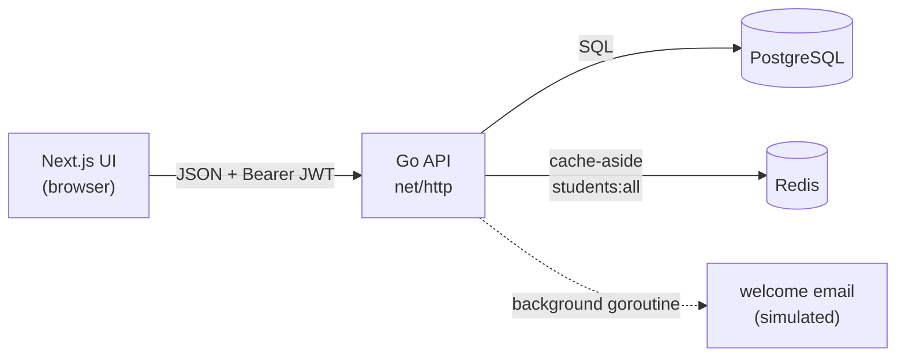

# go-campus-ai

[](https://github.com/ANAXMD/go-campus-ai/actions/workflows/ci.yml)

CampusFlow: a student-directory app. A **Go REST API** (Postgres, Redis cache, JWT auth) with a **Next.js** admin UI. It runs end to end with one `docker compose up` for the backend and `npm run dev` for the front end.

It is a small, conventional full-stack service. The point is to show that the ordinary parts are done properly: validation, auth, caching that stays correct, testable structure, migrations, graceful shutdown, CI.



## Run it

You need Docker, and Node 20+ for the UI.

```bash
# 1. Backend: Postgres + Redis + API on http://localhost:8080
cp .env.example .env          # then edit the two secrets (see the comments inside)
docker compose up --build

# 2. Front end on http://localhost:3000
cd campus-frontend-v2
cp .env.example .env.local
npm install
npm run dev
```

Open http://localhost:3000, choose **Create an account**, and you are signed in. Tables are created automatically on first start.

Or use the API directly:

```bash
curl -s localhost:8080/api/register -d '{"email":"me@campus.edu","password":"correct horse"}'
TOKEN=$(curl -s localhost:8080/api/login -d '{"email":"me@campus.edu","password":"correct horse"}' | sed 's/.*"token":"\([^"]*\)".*/\1/')

curl -si localhost:8080/api/students -H "Authorization: Bearer $TOKEN" | grep -i x-cache   # X-Cache: MISS
curl -si localhost:8080/api/students -H "Authorization: Bearer $TOKEN" | grep -i x-cache   # X-Cache: HIT
```

## API

| Method | Path | Auth | Notes |
|---|---|---|---|
| GET | `/api/health` | no | `200` when Postgres answers, `503` otherwise. Used by the Docker healthcheck. |
| POST | `/api/register` | no | `{email, password}`. Password 8–72 bytes. `409` if the email exists. |
| POST | `/api/login` | no | Returns `{token, email}`. Token is valid for 24 h. |
| GET | `/api/students` | JWT | Cached in Redis. Response header `X-Cache: HIT` or `MISS`. |
| POST | `/api/students` | JWT | `{name, email, major}` → `201` with the created student. |
| PUT | `/api/students/{id}` | JWT | `404` if it does not exist, `409` if the email belongs to someone else. |
| DELETE | `/api/students/{id}` | JWT | `204`, or `404`. |

Every error is `{"error": "message"}` with a meaningful status code. Internal failures return a generic message and log the detail server-side.

## Design decisions

**Cache-aside with explicit invalidation.** `GET /api/students` serves from Redis when it can and fills the cache on a miss. Create, update and delete delete the key after a successful write, so a cached list is never older than the last write. The TTL (10 min) is only a safety net. The first version never invalidated, so a student you had just added did not show up; a test now pins that for all three write paths.

**Redis is optional at runtime.** If Redis is down at startup the API logs it and runs without a cache. If it fails mid-flight, reads fall through to Postgres and a failed invalidation is logged. A cache outage costs speed, never correctness of the response.

**Handlers depend on interfaces, not on `*sql.DB`.** `Store` and `Cache` are small interfaces; Postgres and Redis are one implementation each. That is what lets the HTTP layer be tested thoroughly without a database (see Testing).

**Auth.** Passwords are hashed with bcrypt (cost 12). Login returns the same message and does equivalent work whether the email is unknown or the password is wrong, so it does not reveal which emails are registered. Tokens are HS256 JWTs; the verifier pins the algorithm and requires an expiry, which closes the classic "the token picks its own algorithm" hole. The signing secret comes from the environment and the server refuses to start with one shorter than 32 characters.

**Configuration from the environment, validated at startup.** All problems are reported together instead of one per restart. Nothing secret has a default.

**Migrations are embedded in the binary** and applied at startup, each in its own transaction, tracked in `schema_migrations`, guarded by a Postgres advisory lock so two replicas starting together do not race. The file naming (`000001_name.up.sql`) is compatible with golang-migrate if this ever outgrows the small runner.

**Operational basics.** HTTP server timeouts, connection-pool limits, retrying the database connection on startup (Docker brings Postgres up a few seconds after the API), graceful shutdown on SIGTERM that also waits for in-flight background emails, a multi-stage image that runs as a non-root user.

**The welcome email is simulated.** Creating a student fires a background goroutine that "sends" an email (a log line and a configurable delay), so the response never waits on a slow third party. It is where a real provider call would go.

## Configuration

| Variable | Required | Default | Meaning |
|---|---|---|---|
| `DATABASE_URL` | yes | | Postgres connection string |
| `JWT_SECRET` | yes | | at least 32 characters |
| `REDIS_ADDR` | no | `localhost:6379` | |
| `REDIS_PASSWORD` | no | | |
| `PORT` | no | `8080` | |
| `CORS_ALLOWED_ORIGINS` | no | `http://localhost:3000` | comma separated |
| `CACHE_TTL` / `TOKEN_TTL` | no | `10m` / `24h` | Go duration syntax |
| `WELCOME_EMAIL_DELAY` | no | `3s` | simulated provider latency |

The UI reads `NEXT_PUBLIC_API_URL` (default `http://localhost:8080`).

## Testing

```bash
make check      # gofmt, go vet, go test -race
```

The Go tests (about 60 cases) drive the real HTTP stack with in-memory fakes for the store and cache. They cover registration and login rules, every way a JWT can be wrong (missing, malformed, wrong secret, expired, no expiry, `alg: none`, a validly signed token using a different algorithm), CRUD, validation, conflict and not-found paths, cache hit/miss/invalidation on every write, Redis being down, internal errors not leaking to clients, the background email, configuration, and the migration loader.

Not covered by automated tests: the SQL itself, which needs a live Postgres. The migrations and every query in `store.go` were run by hand against PostgreSQL 16, including applying the migrations twice over existing tables (which is what happens to a database created by the old `init.sql`). An integration test using a Postgres service container in CI is the obvious next step.

CI runs formatting, vet, the race-enabled tests and a Docker build for the backend, and a type check plus production build for the front end.

## Known limitations

- **Every registered user has full access.** There are no roles, and registration is open. Fine for a demo; a real deployment would restrict sign-up and add roles.
- **Tokens live in `localStorage`** and there are no refresh tokens, so a session lasts until the 24 h token expires. Simple, but readable by any script running on the page. An httpOnly cookie would be the hardening step.
- **No rate limiting** on login or registration.
- **The student list is not paginated.** Fine for a campus-sized directory in a cache; it would need paging at larger scale.
- **One cached key for the whole list.** Any write drops all of it. Simple and always correct; per-page keys would be finer grained.
