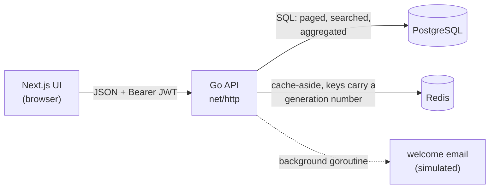

# go-campus-ai

[](https://github.com/ANAXMD/go-campus-ai/actions/workflows/ci.yml)

CampusFlow: a student-directory app. A **Go REST API** (Postgres, Redis cache, JWT auth with roles) with a **Next.js** admin UI. It runs end to end with one `docker compose up` for the backend and `npm run dev` for the front end.

It is a small, conventional full-stack service. The point is to show that the ordinary parts are done properly: server-side paging and search, a cache that cannot serve stale data, role-based access, testable structure, migrations, graceful shutdown, and tests that run against real Postgres and Redis in CI.



## Run it

You need Docker, and Node 20+ for the UI.

```bash
# 1. Backend: Postgres + Redis + API on http://localhost:8080
cp .env.example .env          # then edit the two secrets (see the comments inside)
docker compose up --build

# 2. Front end on http://localhost:3000
cd campus-frontend-v2
cp .env.example .env.local
npm install
npm run dev
```

Open http://localhost:3000, choose **Create an account** and register with `admin@campus.edu` (the address listed in `ADMIN_EMAILS` in `.env.example`). That account is an **administrator**; any other address becomes a read-only **viewer**. Tables are created automatically on first start.

To have something to page through, fill the directory with sample students (60 by default; this signs in as the admin above):

```bash
make seed            # or: make seed N=200
```

If you registered `admin@campus.edu` with a password of your own, pass it: `SEED_PASSWORD='your password' make seed`.

Or use the API directly:

```bash
curl -s localhost:8080/api/register -d '{"email":"admin@campus.edu","password":"correct horse"}'
TOKEN=$(curl -s localhost:8080/api/login -d '{"email":"admin@campus.edu","password":"correct horse"}' | sed 's/.*"token":"\([^"]*\)".*/\1/')

curl -si "localhost:8080/api/students?limit=10&offset=10&q=physics" -H "Authorization: Bearer $TOKEN" | grep -iE "x-cache|total"
```

Run the same request twice: the first answers `X-Cache: MISS`, the second `HIT`.

## API

| Method | Path | Who | Notes |
|---|---|---|---|
| GET | `/api/health` | anyone | `200` when Postgres answers, `503` otherwise. Used by the Docker healthcheck. |
| POST | `/api/register` | anyone* | `{email, password}`. Password 8-72 bytes. `409` if the email exists. Returns the new account's role. *With `ALLOW_REGISTRATION=false` only the `ADMIN_EMAILS` addresses may register (`403` for everyone else). |
| POST | `/api/login` | anyone | Returns `{token, email, role}`. Token is valid for 24 h. |
| GET | `/api/students?q=&limit=&offset=` | any signed-in user | One page: `{items, total, limit, offset}`. `q` searches name, email and major, case-insensitively. `limit` 1-100 (default 25), `offset` 0 or more; anything else is a `400`. Cached per page and per search, `X-Cache: HIT` or `MISS`. |
| GET | `/api/students/stats` | any signed-in user | `{total, majors, topMajor, topCount}`, computed in SQL. Cached the same way. |
| POST | `/api/students` | **admin** | `{name, email, major}` -> `201` with the created student. |
| PUT | `/api/students/{id}` | **admin** | `404` if it does not exist, `409` if the email belongs to someone else. |
| DELETE | `/api/students/{id}` | **admin** | `204`, or `404`. |

`401` means "not signed in or token invalid"; `403` means "signed in, but your role does not allow this". Every error is `{"error": "message"}` with a meaningful status code. Internal failures return a generic message and log the detail server-side.

## Design decisions

**Paging and search happen in the database.** The list endpoint takes `limit`, `offset` and `q`, and returns one page plus the total, so the browser never downloads the whole directory. Search is `ILIKE` on name, email and major, with `%`, `_` and `\` in the input escaped, so searching for `100%` finds "100%" rather than every row. A page and its total are read in one read-only `REPEATABLE READ` transaction, so they always agree even while someone is writing. Bad paging parameters are rejected with a `400` rather than silently clamped, so a client bug shows up instead of hiding. The UI waits 300 ms after the last keystroke before searching, so typing a word sends one request, not one per letter.

**Cache-aside with a generation counter instead of deleting keys.** Every cached page and the stats live under a key like `students:v42:list:10:20:physics`, where `42` is a generation number in Redis. Every successful write does one atomic `INCR` of that number, which makes every cached page from before the write unreachable at once, with no need to find and delete them (they expire on their own after the TTL). This replaced the first approach, delete-on-write, which has a race: a slow reader fetches rows, a writer commits and deletes the key, and then the reader stores its old rows into the cache, where they are served until the TTL expires. With versioned keys that reader writes into a generation nobody reads any more. `TestSlowReaderCannotLeaveAStaleEntryBehind` reproduces exactly that interleaving. The original version never invalidated at all, so a student you had just added did not show up.

**Roles: admin and viewer.** Viewers can read; only admins can create, edit or delete (`403` otherwise). Who is an admin is decided by one setting, `ADMIN_EMAILS`, which the API applies to the database at every startup: listed accounts become admins, everyone else a viewer, in one transaction. That makes the config file the single source of truth, and removing an address demotes it on the next restart. New registrations get their role from the same list. The role travels in the JWT, so authorization needs no database lookup, with one deliberate consequence: a role change takes effect when the user's current token expires (24 h by default) or they sign in again. Tokens issued before roles existed carry no role and are rejected, which sends those users back to sign in.

**Redis is optional at runtime.** If Redis is down at startup the API logs it and runs without a cache. If it fails mid-flight, reads fall through to Postgres and a failed invalidation is logged. A cache outage costs speed, never correctness of the response.

**Handlers depend on interfaces, not on `*sql.DB`, and one contract suite keeps the fakes honest.** `Store` and `Cache` are small interfaces; Postgres and Redis are one implementation each. The HTTP tests use in-memory fakes, which is only worth anything if the fakes behave like the real thing, so a single contract suite (`store_contract_test.go`) runs against both the fake and real Postgres. If they ever disagree, it fails.

**Auth.** Passwords are hashed with bcrypt (cost 12). Login returns the same message and does equivalent work whether the email is unknown or the password is wrong, so it does not reveal which emails are registered. Tokens are HS256 JWTs; the verifier pins the algorithm and requires an expiry, which closes the classic "the token picks its own algorithm" hole. The signing secret comes from the environment and the server refuses to start with one shorter than 32 characters.

**Configuration from the environment, validated at startup.** All problems are reported together instead of one per restart. Nothing secret has a default.

**Migrations are embedded in the binary** and applied at startup, each in its own transaction, tracked in `schema_migrations`, guarded by a Postgres advisory lock so two replicas starting together do not race. The file naming (`000001_name.up.sql`) is compatible with golang-migrate if this ever outgrows the small runner. Existing databases upgrade in place: the roles migration turns every existing account into a viewer until `ADMIN_EMAILS` says otherwise.

**Operational basics.** HTTP server timeouts, connection-pool limits, retrying the database connection on startup (Docker brings Postgres up a few seconds after the API), graceful shutdown on SIGTERM that also waits for in-flight background emails, a multi-stage image that runs as a non-root user.

**The welcome email is simulated.** Creating a student fires a background goroutine that "sends" an email (a log line and a configurable delay), so the response never waits on a slow third party. It is where a real provider call would go.

## Configuration

| Variable | Required | Default | Meaning |
|---|---|---|---|
| `DATABASE_URL` | yes | | Postgres connection string |
| `JWT_SECRET` | yes | | at least 32 characters |
| `ADMIN_EMAILS` | no | | comma-separated; these accounts are admins, everyone else a viewer. With none, the directory is read-only (the API logs a warning). |
| `ALLOW_REGISTRATION` | no | `true` | `false` = invite-only: only `ADMIN_EMAILS` can create an account (so it must not be empty) |
| `REDIS_ADDR` | no | `localhost:6379` | |
| `REDIS_PASSWORD` | no | | |
| `PORT` | no | `8080` | |
| `CORS_ALLOWED_ORIGINS` | no | `http://localhost:3000` | comma separated |
| `CACHE_TTL` / `TOKEN_TTL` | no | `10m` / `24h` | Go duration syntax |
| `WELCOME_EMAIL_DELAY` | no | `3s` | simulated provider latency |

The UI reads `NEXT_PUBLIC_API_URL` (default `http://localhost:8080`).

## Testing

```bash
make check              # gofmt, go vet, go test -race (integration tests skip without services)
make test-integration   # everything, against the compose Postgres and Redis (start them first)
```

There are three layers, all in Go:

- **Handler tests** (the bulk) drive the real HTTP stack with in-memory fakes for the store and cache. They cover registration and login rules, every way a JWT can be wrong (missing, malformed, wrong secret, expired, no expiry, no role, `alg: none`, a validly signed token using a different algorithm, a role edited in the payload), roles and `403` vs `401`, invite-only registration, CRUD, validation, conflict and not-found paths, paging and search, cache hits, per-page cache entries, invalidation on every write, the slow-reader race, Redis being down, internal errors not leaking to clients, the background email, and configuration.
- **A store contract suite** specifies the `Store` interface (ordering, paging and totals, search including literal `%` `_` `\`, conflicts, stats tie-breaking, roles). It runs against the in-memory fake on every `go test` and against real Postgres when `TEST_DATABASE_URL` is set.
- **Integration tests against real services**: the contract suite on Postgres; the migration runner (applying twice, six replicas starting at once, upgrading a database created by an earlier release, a failing migration rolling back completely); the Redis cache (TTL expiry, `INCR`, a closed client); and the whole read path with the real Redis behind it. Each Postgres test creates and drops its own throwaway database.

Set `TEST_DATABASE_URL` (a `postgres://` URL for any database on a server where the user may create databases) and `TEST_REDIS_ADDR` to run them; without those variables they are skipped locally. **On CI they cannot be skipped:** GitHub sets `CI=true`, the tests fail if the variables are missing, and the workflow also fails if any test reports `SKIP`. CI runs the tests against `postgres:16` and `redis:7` service containers with the race detector on, plus a formatting check, `go vet`, a Docker build, and a type check and production build for the front end.

The tests were also checked by breaking the code on purpose and confirming a test notices: unescaped `LIKE` wildcards, the migration advisory lock removed, the role check bypassed, the cache key ignoring the offset, and writes that never invalidate. Each fails a different test. That was done by hand, not in CI.

## Known limitations

- **Search is a sequential scan.** `ILIKE '%text%'` cannot use a normal index. Fine for a campus-sized directory; at larger scale it would want a `pg_trgm` index.
- **Offset paging gets slower on deep pages** and can skip or repeat a row if the data changes between two page requests. Keyset paging fixes both, at the cost of not being able to jump to page N.
- **Roles are managed through configuration**, not through the app. There is no user-management screen or promote endpoint; changing an admin means editing `ADMIN_EMAILS` and restarting.
- **A role change waits for the token to expire** (up to 24 h) because the role is read from the token. Checking the database on every request would make it immediate at the cost of a lookup per request.
- **Registration is open by default.** New accounts are read-only viewers, but they can still read the directory; set `ALLOW_REGISTRATION=false` for invite-only.
- **Tokens live in `localStorage`** and there are no refresh tokens, so a session lasts until the 24 h token expires. Simple, but readable by any script running on the page. An httpOnly cookie would be the hardening step.
- **No rate limiting** on login or registration.
- **The generation counter assumes Redis does not evict it on its own.** Redis only evicts when `maxmemory` is set, which the default image does not do. If it were evicted, the counter would restart and could briefly reuse a key from an earlier generation, for at most one TTL.
